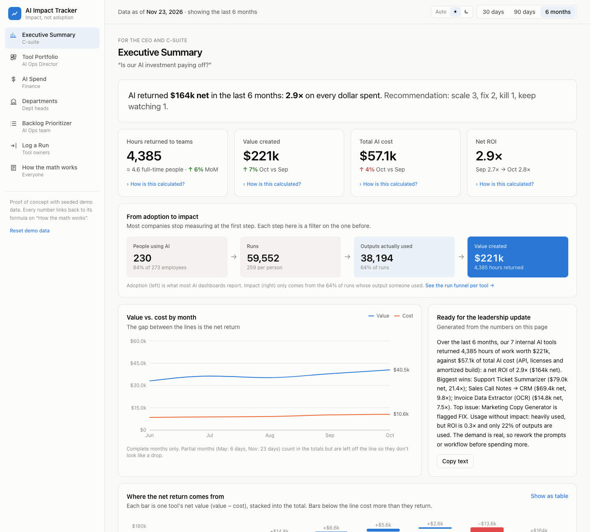

# AI Impact Tracker

Most companies measure AI **adoption**: seats, logins, prompt counts. This tracker measures AI **impact**: what every internal AI tool returns in hours and dollars, against everything it costs. Each tool gets one number, **net ROI**, and an automatic **Scale / Fix / Kill / Watch** recommendation. Every number on screen can be traced back to its formula. Any internal tool reports in with one API call per run.



> Proof of concept. The data is seeded (7 tools, ~60k runs over 6 months), generated relative to today so it always looks current. The spec is in [AI_IMPACT_TRACKER.md](AI_IMPACT_TRACKER.md).

## Run it

**One command (Docker):**

```bash
docker compose up --build
# open http://localhost:8000
```

Demo data is regenerated on every container start.

**Two terminals (local dev):**

```bash
# 1. API on :8000 (Python 3.9+). Seeds itself on first start.
cd backend
pip install -r requirements.txt
uvicorn app.main:app --port 8000

# 2. UI on :5173 (Node 20+), proxies /api to :8000
cd frontend
npm install
npm run dev
```

Re-seed at any time with `python -m app.seed` (from `backend/`) or the **Reset demo data** link in the sidebar.

**Tests:**

```bash
cd backend && python -m pytest -q     # 44 tests: ROI math, flag rules, API acceptance criteria
```

## What's in it

| Screen | For | Answers |
|---|---|---|
| Executive Summary | CEO / C-suite | One-sentence bottom line, KPI tiles, an **adoption → impact chain** (people using AI → runs → outputs used → value), value-vs-cost trend, a **waterfall** of each tool's contribution to net return, top wins and top problem, a paragraph ready to paste into a leadership update |
| Tool Portfolio | Director of AI Ops | Usage-vs-ROI quadrant, **per-tool run funnels as nested bars**, sortable table with users, flag and the reason in plain English |
| Tool Detail | Tool owner | Rule-by-rule explanation of the flag, flag override, monthly value vs cost, success rate, **weekly active users**, the **run funnel**, failure reasons, models used, **editable baseline assumptions** |
| AI Spend | Finance | Spend by tool and by model, cost per *successful* outcome, tools whose cost is growing faster than their value |
| Departments | Dept heads | **Adoption vs. impact** map (who uses AI vs who actually gets time back), a **Sankey** of department → tool → what happened to the output, hours returned vs manual workload, the opportunity gap |
| Backlog Prioritizer | AI Ops team | Ideas ranked by priority score, plus a form that scores a new idea as you type |
| Log a Run | Tool owners | The integration point, explained: the four facts a tool sends, what the tracker already knows, and a **live itemized receipt** (time saved drawn to scale → outcome credit → dollars → minus API cost) with one-click scenarios |
| How the math works | Everyone | Every formula and threshold on one page |

Every headline number has a **"How is this calculated?"** disclosure that shows the formula with the real numbers filled in.

## The math (all of it in [`backend/app/metrics.py`](backend/app/metrics.py))

```
minutes saved   = outcome weight × (baseline minutes − human minutes with AI)
                  weight: accepted 100%, edited 50%, rejected/failed 0%
value           = minutes saved ÷ 60 × loaded hourly rate
cost            = Σ API cost (all runs, including failures)
                + monthly fixed cost, accrued daily
                + build cost ÷ 365 per day, for the first 12 months
net ROI         = (value − cost) ÷ cost
acceptance      = (accepted + edited) ÷ all runs
cost / success  = cost ÷ (accepted + edited)
run funnel      = runs → completed (not failed) → used (accepted + edited) → used as-is
adoption        = distinct people with a run ÷ department headcount
```

**Flags.** Rules are checked in order and the first match wins:

1. **WATCH**: live fewer than 30 days.
2. **FIX (usage without impact)**: top 50% by usage AND (ROI < 1× OR acceptance < 50%).
3. **KILL**: ROI < 1× in each of the last 2 complete calendar months.
4. **SCALE**: ROI ≥ 3× AND acceptance ≥ 70%.
5. **FIX**: everything else.

**Backlog score.** Estimated annual value (tasks/mo × min saved ÷ 60 × $/hr × adoption % × 12) ÷ estimated first-year cost (build hours × $100 + 12 × monthly API cost).

## Decisions where the spec was ambiguous

- **Usage-without-impact is checked before KILL.** The spec wants the Marketing Copy Generator (roughly break-even, so ROI < 1× for months) flagged **FIX**, not KILL. That only works if heavy usage takes precedence. It is also the right business call: people clearly want the tool, so the fix is quality, not removal. KILL is for tools that lose money *and* nobody uses.
- **A 7th tool for WATCH.** None of the 6 tools in the spec has fewer than 30 days of data, so a *PR Description Writer* (Engineering, launched 18 days ago) was added.
- **Legal and Operations departments.** Legal appears in the seed table but not in the department list, so it was added. Operations has heavy manual work and no tools, which makes the opportunity gap visible.
- **Department attribution follows the user, not the owner.** The HR Policy Bot is owned by HR but used company-wide, so its value goes to whoever asked. Fixed and build costs are split by run share, so department totals add up exactly to the company total (there's a test for this).
- **"Today" is the date of the latest run**, not the wall clock. The demo doesn't drift if you open it a week after seeding.
- **ROI is deliberately conservative.** Time spent reviewing rejected outputs is shown on each tool page but is not subtracted from value. A run where the person took *longer* than the baseline counts as negative value rather than being clamped to zero.
- **Spend growth compares the last complete month with 3 months earlier**, a quarter of trend rather than one noisy month.

## Integrating a tool

```bash
curl -X POST http://localhost:8000/api/runs \
  -H 'Content-Type: application/json' \
  -d '{"tool_id": 1, "human_minutes_with_ai": 2, "api_cost_usd": 0.03,
       "model_name": "claude-haiku-5-5", "outcome": "accepted"}'
```

The response prices the run step by step (minutes saved, outcome credit, value, net). `POST /api/runs/preview` returns the same breakdown without saving. Optional fields: `user_id` (anonymous, powers adoption), `user_department_id`, `failure_reason`, `timestamp`.

Other endpoints: `GET /api/summary?range=1m|3m|6m`, `GET /api/tools`, `GET /api/tools/{id}`, `PATCH /api/tools/{id}`, `GET /api/spend`, `GET /api/departments`, `GET|POST /api/ideas`, `POST /api/ideas/score`, `GET /api/meta`. Interactive docs are at `/docs`.

## 2-minute demo script

1. **Hook.** "Most companies measure AI adoption. This measures AI impact: every tool, every run, in dollars."
2. **Executive Summary.** "Across 7 tools, AI returned ~4,400 hours and ~$220k in six months, at about 2.9× net ROI after licenses and amortized build cost." Open a *How is this calculated?* to show it isn't a black box.
3. **Adoption ≠ impact.** On the summary's adoption → impact chain: "84% of employees use AI. That's what most dashboards stop at. Only 64% of runs produce something people use." On **Departments**: "Engineering and Operations adopted AI widely but get under half an hour a month back per person. They only have the generic HR bot."
4. **Portfolio quadrant.** "The Marketing Copy Generator is the second most-used tool, but only 22% of its drafts get used. That's usage without impact, so it gets FIX. The Contract Clause Checker is barely used and loses money every month, so it gets KILL." On **AI Spend**: "Marketing upgraded to a bigger model in August. Cost rose 45% and acceptance didn't move, so the model wasn't the problem."
5. **Live edit.** Open *PTO / HR Policy Bot* (FIX, ROI ~1.9×) and change the baseline from 5 to 10 minutes. ROI and the flag recalculate to SCALE across the app. "The assumptions are explicit, and leadership can challenge them."
6. **Backlog.** "Before we build anything, we score it. Order Exception Triage for Operations, our biggest gap, returns about 8× its first-year cost, so it's next."
7. **Close.** "Any internal tool reports in with one API call (show *Log a Run*: pick "Thrown away" and the receipt shows that run is pure cost). Next steps are Salesforce, Slack and LLM-provider integrations, SSO with role-based views, and scheduled reports."

## Layout

```
backend/
  app/metrics.py    all ROI / flag / scoring math (pure functions)
  app/service.py    SQL aggregation → metrics → screen payloads
  app/main.py       FastAPI routes; serves the built frontend in production
  app/seed.py       deterministic 6-month seed; each tool profile documents its story
  app/db.py         SQLite schema
  tests/            unit tests for the math + API acceptance tests
frontend/           React + TypeScript (Vite), Recharts, Tailwind
Dockerfile          builds the UI, then runs the API serving it on :8000
```

## Out of scope (next steps)

Authentication and roles, real integrations (Salesforce, Slack, LLM provider usage APIs), multi-tenancy, exports and email reports.
